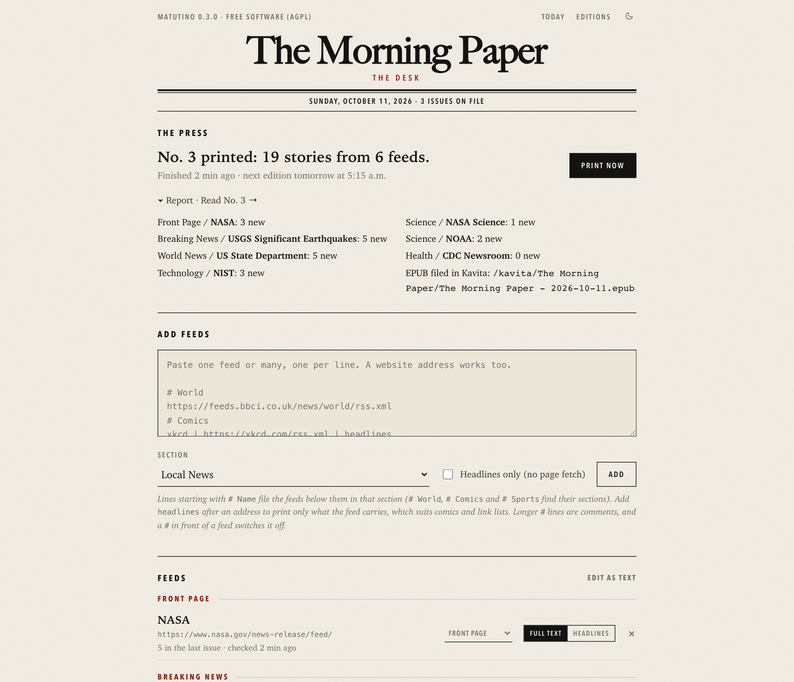

# Matutino

**Your own morning newspaper, printed from the feeds you choose.**
*Tu propio periódico matutino, impreso con los feeds que tú eliges.*

https://github.com/user-attachments/assets/8807b893-c624-4ab4-9fe7-3b7abda94197

Matutino is a small self-hosted app that reads the RSS/Atom feeds you pick,
fetches each story's full text, and every morning prints a newspaper: a
classic broadsheet you read in any browser on your network, and an EPUB for
your e-reader or Kavita library. No algorithm decides what you see, nothing
is personalised, and reading the paper never contacts the outside world: the
stories and pictures are stored when the paper is printed.


| Editions | An article | The desk |
|---|---|---|
|  |  |  |

## Why I built it

For years my reading ran through Google Reader, then Instapaper and Pocket:
clean, full-text articles I could read later on a tablet or e-reader, next to
the newspapers I grew up with. Google Reader closed in 2013 and Pocket in 2025,
and what replaced them came with a third party deciding what to surface, plus
advertising.

I wanted the parts I liked, under my own roof: a self-hosted replacement for a
traditional newspaper combined with an RSS aggregator. The sources are the ones
I choose, nothing is curated or ranked for me, there are no ads, and the result
reads like a paper with a front page, sections and an end, rather than an
endless feed. Matutino has no "save this page" button; the feeds you subscribe
to arrive each morning as clean articles, in the browser and as an EPUB.

## What it does

- **Your sections, your sources.** Paste feeds (or just site addresses) into
  the desk and file them under sections: Front Page, Local News, World,
  Business, Science, Sports, Funnies... The list and its order are yours.
- **Full stories.** Each article is extracted from its page
  ([trafilatura](https://github.com/adbar/trafilatura)), cleaned to safe HTML,
  and its pictures saved and scaled down. If a page can't be read, the feed's
  own text is printed and marked as an excerpt.
- **A real front page.** A lead story and a column of top stories, a red
  *Breaking* band, a weather box and *On this day*, then each section in its own
  grid. A night edition follows your system's dark mode.
- **Editions.** Every issue is kept (14 days by default) and shown as a
  miniature of its own front page.
- **EPUB.** Each issue is also bound as an EPUB 3 book, with series metadata,
  so Kavita lists one series with an issue per day. The paper's download link
  works with any e-reader.
- **In your language.** The paper's own words (dates, labels, weather,
  section names) follow the Language setting: English, Spanish, German,
  French, Portuguese, Italian, Swedish, Russian, Ukrainian, Bosnian, Turkish,
  Arabic (laid out right to left) and Chinese, the languages Wikipedia
  publishes *On this day* in. Stories print in their feeds' language.
- **On your home screen.** The paper installs like an app on a phone, tablet
  or computer, with its own icon and your paper's name under it.
- **In your e-book reader.** Reading apps that browse OPDS catalogs (Librera,
  Readest, KOReader) subscribe to the paper once; each new issue arrives in
  them as an EPUB.
- **On a server or on your computer.** Run it in Docker on a home server, or
  download the Mac or Windows app, which keeps the paper in the menu bar.
- **Small.** Python and a handful of libraries, one container, no database
  server; it runs comfortably in a container capped at 512 MB of memory.

## Desktop app (Mac and Windows)

No server needed: download the app from the
[latest release](https://github.com/virtualawyer/matutino/releases/latest).

| Computer | Download |
|---|---|
| Mac with Apple silicon (M1 or later) | `Matutino-<version>-macOS-AppleSilicon.zip` |
| Mac with an Intel processor | `Matutino-<version>-macOS-Intel.zip` |
| Windows 10 or 11, 64-bit | `Matutino-<version>-Windows-Setup.exe` (or the portable `.zip`) |

The apps aren't signed (signing costs a yearly fee, and Matutino is free), so
your computer warns you the first time:

- **Mac:** unzip, drag Matutino into Applications and open it. macOS says it
  could not verify the app; click **Done**. Open **System Settings > Privacy &
  Security**, scroll to the message about Matutino, click **Open Anyway** and
  then **Open**. You do this once. (On macOS 14 or older, Control-click the app
  and choose **Open** instead. From Terminal:
  `xattr -dr com.apple.quarantine /Applications/Matutino.app`.)
- **Windows:** run the Setup file. If SmartScreen says **Windows protected your
  PC**, click **More info**, then **Run anyway**. It installs for your user
  only (no administrator password) and offers to open Matutino when you sign in.

Then:

- Matutino lives in the menu bar (Mac, the **M.** icon) or the notification
  area (Windows; it may be behind the **^** arrow). Its menu opens the paper
  and the desk, prints now, shows the EPUB folder, and switches **Open at
  login** on or off.
- The first time, the desk opens: paste some feeds and click **Print now**. A
  new paper follows your computer's time zone and language.
- It prints at the time set on the desk while the computer is on. If the
  computer was asleep or off, it prints as soon as Matutino runs again, so
  leave **Open at login** on.
- The paper opens in your browser at `http://127.0.0.1:8771` and answers only
  on this computer.
- Each issue's EPUB is saved in **Documents/Matutino**. The database and issues
  live in `~/Library/Application Support/Matutino` (Mac) or
  `%LOCALAPPDATA%\Matutino` (Windows), with a log in `matutino.log`.
- To remove it, switch **Open at login** off and quit from its menu, then
  delete the app (Mac) or uninstall it in **Settings > Apps** (Windows). Delete
  the data folder too if you want the issues gone.

## Quick start (Docker)

```
docker build -t matutino .
docker run -d --name matutino --restart unless-stopped -p 8771:8771 \
  -v /opt/matutino:/config -e TZ=Europe/Madrid matutino
```

Or skip the build and use the image published with each release
(`linux/amd64` and `linux/arm64`): `ghcr.io/virtualawyer/matutino:latest`.

Open `http://<server>:8771/desk`, paste a feed pack from [`docs/feeds/`](docs/feeds)
(or your own feeds), and click **Print now**. The paper is at
`http://<server>:8771/`. It prints itself every day at the time set on the desk
(05:15 by default).

With Kavita, and the printed issues on a bigger drive, use
[`docker-compose.yml`](docker-compose.yml):

| Volume | What | Where to put it |
|---|---|---|
| `/config` | the SQLite database (small) | a normal Linux filesystem, **not** exFAT/FAT: SQLite needs file locking |
| `/issues` | printed issues and their pictures (tens of MB a day) | any drive, exFAT is fine |
| `/kavita` | your Kavita *Book* library folder | Matutino files each EPUB in one folder inside it |

Without Docker: `pip install -r requirements.txt`, then
`python -m matutino --data ./data`. Python 3.9 or newer; without the
requirements it still runs and prints each feed's own text.

### Settings in the environment

| Variable | Default | |
|---|---|---|
| `MATUTINO_DATA` | `data` (`/config` in Docker) | database folder |
| `MATUTINO_ISSUES` | `<data>/issues` | printed issues; may be another drive |
| `MATUTINO_EPUB_DIR` | none | Kavita library folder to file EPUBs in (`/kavita` in the compose file) |
| `MATUTINO_PORT`, `MATUTINO_HOST` | `8771`, `0.0.0.0` | |
| `MATUTINO_PASSWORD` | none | put the whole site behind a password (any user name) |
| `MATUTINO_ALLOW_PRIVATE` | off | let article pages and pictures come from local-network addresses |
| `TZ` | `UTC` | default time zone for the paper (also settable on the desk) |

Everything else (paper name, sections, print time, weather place, language,
stories per feed, how long to keep issues) is on the desk.

## On your home screen

The paper can sit on your home screen like an app: its own icon, your paper's
name, no browser bars. Tap the phone icon in the paper's top strip (next to the
moon); it installs the paper where the browser allows that, or says how:

- **iPhone and iPad:** in Safari, tap **Share**, then **Add to Home Screen**.
- **Android:** in Chrome, open the menu and choose **Add to Home screen** or
  **Install**.
- **Mac and Windows:** Chrome and Edge show an install button in the address
  bar.

Browsers install web apps fully only from `https://` addresses (and from the
desktop app's own `127.0.0.1`). On a plain `http://` address on your home
network, Android and computer browsers add a shortcut that opens in the
browser instead; iPhone and iPad add the icon either way.

## Reading on a phone or tablet

There's no Matutino phone app: a good e-book reader does that job better. Each
issue is an EPUB, and the paper publishes an **OPDS catalog** of its issues, the
format e-book readers use to browse libraries. Add it once and every morning's
issue shows up in the reader, newest first.

The catalog's address is on the desk: `http://<server>:8771/opds`. Your phone
has to reach the server: on your home Wi-Fi, or away from home through a VPN
into your network (WireGuard, Tailscale).

**Android: [Librera Reader](https://librera.mobi)**

1. Install Librera from Google Play (the F-Droid build has been reported to
   leave out online catalogs).
2. Open the **Networks** tab and tap **+**.
3. Enter the catalog address and a name (your paper's name, say) and tap
   **ADD**.
4. Tap the catalog to see the issues; tap one to download and open it.

Librera's catalog dialog has no password field: if your paper has a password
(`MATUTINO_PASSWORD`), use Readest.

**iPhone, iPad and Android: [Readest](https://readest.com)** (free and open
source; also on Mac, Windows and Linux)

1. In the library, open the import menu in the header and choose **Online
   Library**.
2. Add a catalog with the address above. If your paper has a password, enter
   it (any user name).
3. The catalog appears at the top of the library. On iPhone and iPad, allow
   Readest to find devices on your local network when it asks (or later in
   **Settings > Privacy & Security > Local Network**).

**Apple Books, or any reader:** open the paper in the phone's browser, tap
**Download EPUB** at the foot of the front page, and open the file in the
reader.

**With the desktop app:** it answers only on its own computer, so a phone can't
reach its catalog. Its EPUBs are in **Documents/Matutino**: if your Documents
folder syncs (Desktop & Documents in iCloud Drive on a Mac, OneDrive on
Windows), each issue reaches the phone's Files app, and Readest or Books open
it from there. Readest on the same computer can use
`http://127.0.0.1:8771/opds`.

## Sections

One per line on the desk, in printing order. A few have jobs, which follow the
name (so "Comics" works like Funnies):

- **Front Page**: its feeds supply the lead story and the right-hand column.
  Without Front Page feeds, the top story of each news section is used.
- **Breaking News**: printed as a red band under the masthead.
- **Weather**: carries a forecast box (today plus three days) from
  [Open-Meteo](https://open-meteo.com). Set the place on the desk ("Town,
  Country"); there is no weather until you do.
- **Variety**: carries *On this day* from Wikipedia, in the paper's language.
- **Funnies** and **Opinion** never lead the paper.

Spanish names do the same jobs (Portada, Última hora, Clima, Variedades,
Tiras cómicas, Opinión), and accents don't matter when matching.

**Printed names.** A section's stored name is what its feeds and its job
follow; what the paper prints can differ. The usual sections print in the
paper's language (on a Spanish paper World News is *Internacional* and Funnies
*Tiras cómicas*; on a German one, *Welt* and *Comics*). To print any section
under a name of your own, add it after an equals sign on the desk:

```text
World News = Mundo
Local News = Nacionales
```

The new name shows in the section menu, the headings, the story kickers and
the EPUB, in older issues too. Feeds pasted under `# Mundo` land in that
section.

## Languages

Pick the paper's language on the desk. It sets the dates, labels, weather and
section names on the web paper and in the EPUB, and the edition of Wikipedia
that *On this day* comes from. An Arabic paper is laid out right to left,
while a story keeps its own feed's direction. The desk itself stays in English.

To add a language (or change a word in one), put a pack in a `languages`
folder inside the data folder, named for its code (`nl.json`, `pt.json`), and
restart Matutino. Copy one of the packs in
[`matutino/languages/`](matutino/languages/) as a start: it holds the native
name, `dir` (`ltr` or `rtl`), the labels under `strings`, `days` (Monday
first), `months`, and the date and time patterns. Labels you leave out, or
whose `%s`/`%d` codes don't match the English ones, print in English. *On this
day* stays in English for languages Wikipedia doesn't publish it in.

## Adding feeds

```
# World News
https://feeds.bbci.co.uk/news/world/rss.xml
Al Jazeera | https://www.aljazeera.com/xml/rss/all.xml
# Funnies
xkcd | https://xkcd.com/rss.xml | headlines
('SMBC', 'https://www.smbc-comics.com/comic/rss', 'feed'),
```

A `# Name` line starts a section (`# World` and `# Sports` find their sections
on the list; unknown names become new sections). Longer `#` lines are
comments, and a `#` in front of a feed switches it off. `headlines` after an
address prints only what the feed carries, which suits comics and link lists.
Site addresses work too; their feed is found for you. **Edit as text** on the
desk shows the whole list in this format.

Two tested packs are included: [English](docs/feeds/english.txt) and
[Costa Rica / Puerto Rico, Spanish first](docs/feeds/espanol-costa-rica-puerto-rico.txt).

## How a paper is printed

1. Every feed is read. From each, up to *stories per feed* (default 5) **new**
   stories are taken: not printed before, and published since the previous
   issue (at least the last 36 hours; a newly added feed reaches back a week).
2. Each story's page is fetched and its article extracted; pictures are
   downloaded, scaled to 1400 px and stored with the issue.
3. The issue is assembled in a temporary folder and swapped in only when
   complete, then bound as an EPUB, copied to Kavita, and old issues pruned.
4. Printing again on the same day reprints that day's issue in full.

A failed or empty scheduled print is retried every 30 minutes, at most four
times a day. Below 300 MB of free space the paper prints without pictures.

## Kavita and unplugged drives

Matutino leaves a marker file in its library folder and in its Kavita folder.
If it has written there before and the marker is gone, the drive is almost
certainly not mounted (common with USB drives at boot): the paper refuses to
print into the empty mount point rather than filling the system disk, and the
desk says why. Restart the container once the drive is back.

## Security

Matutino is built for a home network.

- **No accounts.** Set `MATUTINO_PASSWORD` to require a password for the whole
  site. Don't expose it to the internet without HTTPS in front (a reverse proxy
  such as Caddy or Traefik) and a password.
- **Feeds are untrusted.** Story HTML goes through an allowlist cleaner and is
  served with a strict Content-Security-Policy. Article pages and pictures may
  not point into your local network, checked on every redirect, so a hostile
  feed can't make Matutino probe your router. Feeds you add yourself may be
  local.
- **Changes need JSON.** The desk's actions only accept `application/json`, so
  another website can't submit them through your browser.
- **The desktop app keeps to itself.** It listens on `127.0.0.1` only and
  answers only to its own address, so a web page can't reach it by pointing a
  domain name at your computer.

## Using it responsibly

Matutino is a personal reader: it prints the stories you subscribed to, for
you. Please keep it that way.

- It identifies itself honestly (`Matutino/<version>`). Some news sites refuse
  anything that isn't a browser; the desk's **Identify as a web browser** switch
  lets you decide whether to present as one.
- It reads only what a page serves publicly. It doesn't log in or get around
  paywalls; for paywalled sites you get the feed's excerpt and a link.
- Don't republish what it prints. Publishers' articles and pictures remain
  theirs.

## Develop

```
python3 -m venv .venv && .venv/bin/pip install -r requirements.txt
.venv/bin/python -m matutino --data data --epub-dir data/kavita   # http://localhost:8771
.venv/bin/python -m matutino --data data --print-now              # one issue, then exit
.venv/bin/python tests/run.py                                     # no network needed
```

| Module | Job |
|---|---|
| `fetch.py` | one GET: size caps, gzip/Brotli, User-Agent, local-network guard |
| `feeds.py` | RSS/Atom/RDF parsing, feed discovery, paste parsing |
| `sanitize.py` | allowlist HTML to well-formed XHTML |
| `extract.py` | trafilatura wrapper |
| `images.py` | picture scaling and re-encoding (Pillow) |
| `build.py` | picks, fetches, stores, binds and files an issue; pruning |
| `epub.py` | EPUB 3 writer (+NCX) with series metadata |
| `boxes.py` | weather (Open-Meteo) and On this day (Wikipedia) |
| `sections.py` | section list, section jobs, name matching |
| `i18n.py` | the paper's words: English and Spanish, plus the packs in `languages/` |
| `opds.py` | the reading-app catalog (OPDS) and the home-screen manifest |
| `desktop.py` | the desktop app: menu bar / notification area, open at login |
| `render.py` | the paper: front page, articles, editions |
| `desk.py` | the desk page |
| `server.py` | HTTP, JSON API, scheduler |
| `db.py` | SQLite: settings, feeds, issues, printed stories |

The desktop app is bundled with PyInstaller, on the system it is for:

```
python3 -m venv .venv-desktop && .venv-desktop/bin/pip install -r desktop/requirements.txt
.venv-desktop/bin/pyinstaller --noconfirm desktop/matutino.spec   # dist/Matutino.app (or dist\Matutino)
dist/Matutino.app/Contents/MacOS/Matutino --check                 # the bundle checks itself
```

Each release tag builds the Mac (Apple silicon and Intel) and Windows apps on
GitHub and attaches them to the release; `desktop/windows.iss` is the Windows
installer (Inno Setup). `python desktop/icon/make_icon.py` redraws the icons.

`deploy.sh` (run on your computer) and `install.sh` (run on the server) copy
the source to a Docker host over SSH, build the image there and start the
container. `install.sh` finds a running Kavita container and its library
folder by itself.

## How it's built

Matutino was written with [Claude Code](https://www.anthropic.com/claude-code),
Anthropic's AI coding tool. Claude wrote the code, the tests and this
documentation, working from my requirements: what the paper should look like,
which sections it needs, how it should behave on a small home server. I made
the design calls, tested each step, and run it on my own home server, where it
prints my daily paper. Commits carry a `Co-Authored-By: Claude` line, which is
why GitHub lists Claude as a contributor.

How it's kept honest:

- **103 automated tests** that need no network (a local test server plays every
  outside site) run on every push: Python 3.10 to 3.13 with the libraries, and
  3.9 and 3.13 without them. They cover feed parsing, the HTML cleaner, the
  printing rules, the EPUB structure, the local-network guard, the password and
  every language; the pages' inline scripts are syntax-checked too.
- **Real-world checks**: the feed packs were tested against the live sites, and
  bugs found that way (accented addresses, Brotli-only servers, malformed feeds)
  were fixed with a test that reproduces each one.
- **A small footprint** on purpose: Python's standard library plus trafilatura,
  Pillow, brotli and tzdata; SQLite; server-rendered pages with no JavaScript
  framework and no build step.

Issues and pull requests are welcome.

## License and credits

Matutino is free software under the [GNU Affero General Public License
v3.0](LICENSE) or later. If you run a modified version for others over a
network, you must offer them its source.

Built on [trafilatura](https://github.com/adbar/trafilatura) (Apache-2.0),
[Pillow](https://python-pillow.org) (MIT-CMU), [brotli](https://github.com/google/brotli)
(MIT) and [lxml](https://lxml.de) (BSD). Weather data by
[Open-Meteo](https://open-meteo.com) (CC BY 4.0); *On this day* from
[Wikipedia](https://www.wikipedia.org) (CC BY-SA 4.0).
